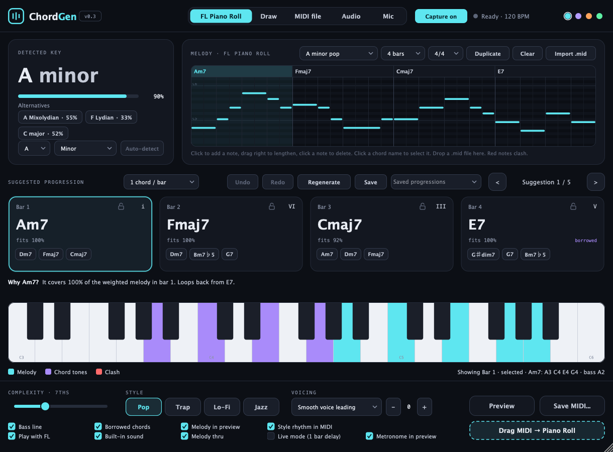

# ChordGen

**Free, open-source chord suggestions for your melody.** ChordGen listens to a melody from the FL Studio piano roll, an audio track, a microphone or an audio file, detects the key and suggests chord progressions that fit. Drag the result straight into the piano roll as MIDI.

<p align="center">
  
</p>

Formats: **VST3** and **Standalone** for Windows and macOS (Intel and Apple Silicon). Built for FL Studio; works in other VST3 hosts.

**⬇️ Download:** get the ready-to-install plugins for Windows and macOS from the [latest release](https://github.com/neog1975/ChordGen/releases/latest) (install steps are on that page).

> Status: early version (v0.3). Feedback, bug reports and pull requests are very welcome.

## Two plugins

FL Studio sends piano-roll notes only to instruments and audio only to effects, so ChordGen comes in two variants built from the same code:

| Plugin | Where in FL | Listens to |
|---|---|---|
| **ChordGen** | Channel Rack (instrument) | the notes in its piano roll |
| **ChordGen FX** | Mixer insert (effect) | an audio track or a microphone, one note at a time, or an audio file you drop on it (polyphonic) |

## How it works

1. Write a melody in ChordGen's piano roll (or sing/play into ChordGen FX) and press Play in FL.
2. After one pass of the pattern ChordGen takes the melody, detects the key and suggests five progressions.
3. Browse suggestions, swap single chords for alternatives, lock the ones you like and regenerate the rest.
4. Drag **Drag MIDI → Piano Roll** into FL, or save a `.mid` file.

## Features

- Key detection (Krumhansl profiles, re-ranked by how well the key's chords fit) with manual key lock; major, minor, harmonic minor and church modes
- Chord scoring per bar with exact note timing (1/24 beat), borrowed chords and secondary dominants
- Progression search with style habits: **Pop**, **Trap**, **Lo-Fi**, **Jazz**
- Complexity from triads to 7ths, 9ths and jazz voicings, with smooth voice leading
- 1 or 2 chords per bar, or one chord per 2 bars; 4, 8 or 16 bars; 4/4, 3/4 and 6/8
- Lock and regenerate, undo/redo, saved progressions
- Clash display: melody notes that fight the chord turn red, with an explanation of each choice
- Built-in sound (pad, bass, melody) synced to FL, plus MIDI out for your own synths
- **ChordGen FX**: YIN pitch tracking with live note and cents display, metronome, and a **Live mode** that plays the chord for the bar you just played
- MIDI import and export
- **ChordGen FX**: drop an audio stem (WAV, AIFF, MP3 or FLAC) and it listens for the chords, see below

## Chords from an audio file (ChordGen FX)

Drop an audio file onto ChordGen FX, or click **Load audio...**. ChordGen listens to it in the background, so FL keeps playing and the plugin stays responsive, and shows the progress over the melody roll:

1. Hears which notes sound, chords included, with [Basic Pitch](https://github.com/spotify/basic-pitch) (Spotify's polyphonic pitch model), embedded in C++ the way [NeuralNote](https://github.com/DamRsn/NeuralNote) does it. Nothing is sent anywhere; it all runs on your computer.
2. Keeps the audio as sound, not MIDI: per beat, how strongly each of the 12 note names sounds, and which note is lowest. The roll shows this, each row a note name, the current chord's tones lit up. Using FL's tempo (the Standalone app asks for it), it starts at the first bar that sounds and assumes the file starts on a bar line. Up to 16 bars are used.
3. Recognises the chord in each bar from that sound: the chord's tones should carry the sound, other tones count against it, and the lowest note names the root. Style, complexity, locks and Regenerate work as for a melody.

On ten 128 BPM chord stems from a sample pack, the root and major/minor heard matched the producer's MIDI in 56 of 76 bars; most of the rest were extended chords that read either way (Cmaj7 or Em, Am7/G or G6). On the keyboard and synth stems of a song, 31 of 32 bars. Whole songs work well too, since the bass, the chords and the melody together make the harmony clear. Stems that play chords work best; a guitar riff or a bass line on its own does not show the chord, and gives wrong chords.

Drop a whole song or a stem that plays chords (piano, keys, synth, pad, guitar chords). Files without harmony get a message in place of chords:

- **Drums or percussion only.** Mostly percussive sound, with hardly any notes, or with every note on one pitch (a tuned kick).
- **No notes.** Risers, impacts and other effects with only a few stray notes.

Only the first 3 minutes of a file are analysed. A 3-minute stem takes about 10 seconds on a 2017 Intel iMac (Core i5).

## Building

Requirements: CMake 3.22+, a C++17 compiler (Xcode command line tools on macOS, Visual Studio on Windows) and JUCE 8.

```bash
git clone https://github.com/neog1975/ChordGen.git
cd ChordGen
git clone --depth 1 --branch 8.0.8 https://github.com/juce-framework/JUCE.git JUCE
cmake -B build -DCMAKE_BUILD_TYPE=Release
cmake --build build --config Release
```

On macOS the plugins are copied to `~/Library/Audio/Plug-Ins/VST3` after building (turn this off with `-DCHORDGEN_COPY_PLUGIN=OFF`). Every push is also built for Windows and macOS by GitHub Actions.

### Tests

Configure with `-DCHORDGEN_TESTS=ON` to build:

- `ChordGenTests`: simulates FL playing a melody and checks capture timing and MIDI import
- `PitchTests`: runs a synthetic sung melody through the pitch tracker
- `AudioImportTests [files]`: runs a synthetic piano stem, bass stem, mastered full mix and drum loop through Basic Pitch and the check for files without harmony, and checks the chords heard in the piano stem and the full mix. Given audio files, it reports what it hears in each instead; `--chords <bpm> stem.wav chords.mid ...` compares the chords heard with the chords in MIDI files
- `MidiBatch <folder>`: imports every MIDI file in a folder and reports any note whose timing changed
- `ChordEval <folders> [--songs]`: compares ChordGen's chords with the chords producers wrote in chord packs or full arrangements

## License

ChordGen is released under the [GNU Affero General Public License v3.0](LICENSE). It is built with [JUCE](https://juce.com), which is available under the AGPLv3 or a commercial license.

ChordGen FX includes third-party code and a machine-learning model, each under its own license, all compatible with the AGPLv3:

- **Basic Pitch** model and weights by Spotify: [Apache License 2.0](ThirdParty/BasicPitch/LICENSE) ([notice](ThirdParty/BasicPitch/NOTICE-basic-pitch))
- **NeuralNote**'s C++ port of Basic Pitch by Damien Ronssin and Tibor Vass: [Apache License 2.0](ThirdParty/BasicPitch/LICENSE). The changed and new files are listed in [ThirdParty/BasicPitch](ThirdParty/BasicPitch/README.md)
- **RTNeural** by Jatin Chowdhury: BSD 3-Clause, downloaded at build time (with Eigen, MPL 2.0, and nlohmann/json, MIT)
